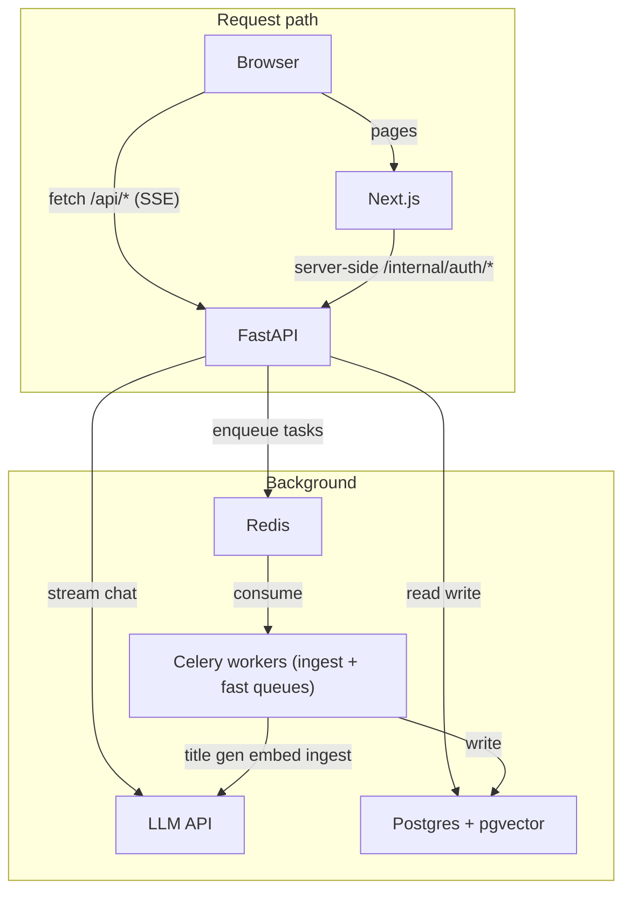

# If anything is written by a human in this repo, it's this note

As of Nov 6, 2026, this repo is officially retired. It will receive no more maintenance. It has served its purpose and I have gone on to make a private fork of it to develop a real business application.

Documentation of the entire process in the form of a course: [How hax was built](docs/course/README.md)

It has been a surreal learning experience. I started the project with little full-stack experience (my professional background is data), and have grown a lot over the entire time I have been working on it. If you dig into the repo's commit history, you'll see that I moved very slow and committed very little in the beginning. "Why is this guy taking this much time to build something so simple that Claude can oneshot?"

I still believe in the fundamentals of full-stack development. Most of the early days was spent probing and interrogating Claude how Next is set up, how requests travel between Next and FastAPI, why something is written a certain way in TypeScript, how React hooks even work, how tools are called by the harness. Listing all my questions for the sake of "learning full-stack" would make the modern AI Engineer lol hard. But all that front loading paid off well (I think), as my ability to review code and make design decisions have been much faster, and I was confidently orchestrating instead of developing in the tail end of the project. If I did what I'm doing now when I first started out, I would never have approved any of Claude's output code, due to the lack of confidence in understanding my own codebase.

I chose this idea because of the thing that started the whole AI craze: ChatGPT. LLM is at the frontier of AI, and a chatbot is something probably every product out there uses to some extent, so let's build something that is so general purposed that any future product could find useful. The project's scope ended up ballooning through all the decisions I added along the way, but I'm glad I always had a "who cares, let's implement this" mindset. Probably a terrible mindset to have when business is involved and speed is of utmost importance, but I did learn a lot by just randomly doing things.

I have poured a lot of love into this project. I hope you will find hax useful, whether you developed your own harness, or just a feature on your app. If you're just here to learn as a non-technical person starting out, I definitely recommend follow the course listed above, which I documented all of my processes in written form.

## hax

AI-first product: primary interface is a **chat experience** that answers user questions using the user's own data and context. This repo is **v0** — an open-source skeleton that ships the full vertical slice. When v0 is done, no further code is added here; a private repo forks from it for v1, the proprietary domain-specific version.

## Goal (v0)

- Chat produces a direct answer grounded in the user's data, a short explanation of what data was used, and structured output (e.g. tables) when helpful.
- User can sign in, provide or connect data, ask questions in chat, and see results in table/structured view.
- Product feels cohesive; we can add data sources, question types, and agent capabilities without rewriting everything.

**Non-goals:** perfect agent autonomy, over-optimized architecture, full enterprise compliance. **Principles:** working software over perfect abstractions; minimal testable vertical slices; treat user data as sensitive.

## Run it locally

Prerequisites: Python 3.11+, Node.js 22.22+, Docker with docker-compose 2+, Make, and optionally [direnv](https://direnv.net) (on Windows, use WSL2).

```bash
source setup.sh      # venv, dependencies, .env from .env.example, pre-commit hooks
# Fill in .env: ANTHROPIC_API_KEY, VOYAGE_API_KEY, and AUTH_SECRET and
#   INTERNAL_API_SECRET as two different `openssl rand -base64 32` values
direnv allow         # needs direnv hooked into your shell; otherwise, in each shell:
                     #   source .venv/bin/activate && set -a && source .env && set +a
make infra-up        # with Docker running: Postgres, Redis, RustFS, Mailpit
make migrate         # create the database schema
make dev             # FastAPI and Next.js
make worker          # second terminal: ingestion, email, titles and the sweeps
```

The full guide is [docs/dev-setup.md](docs/dev-setup.md): the keys and secrets (Auth setup), loading the environment, running the production stack locally, deploying, migrations, tests and debugging.

## Stack

| Layer      | Tech                                                                              |
| ---------- | --------------------------------------------------------------------------------- |
| Frontend   | Next.js (SSR + routing), React, TypeScript, Tailwind v4 (design tokens, ADR 0014) |
| Backend    | FastAPI                                                                           |
| LLM        | Anthropic SDK — hand-rolled agentic tool-use loop (ADR 0002)                      |
| Embeddings | Voyage AI (ADR 0007); LangChain for text splitting only (ADR 0009)                |
| Streaming  | SSE (FastAPI `StreamingResponse`) for chat                                        |
| Async      | Celery + Redis (broker + cache)                                                   |
| Data       | Postgres + pgvector (embeddings)                                                  |
| Storage    | Object storage for uploads — S3 in prod, RustFS in dev (boto3)                    |
| Email      | Transactional email — Mailpit (dev), real SMTP relay in prod                      |
| Types      | OpenAPI spec → generated TypeScript (openapi-typescript)                          |
| Infra      | Docker, Docker Compose                                                            |
| Deploy     | AWS (EC2 + RDS + S3) via Terraform; GHCR images; SSM roll (ADR 0013)              |

## Status

Milestones 1–4 (streaming chat, data + RAG, auth, live on AWS, structured
outputs + polish) have shipped; milestone 5 (cleanup, hardening, eval) is in
its final pass, with its test infrastructure and the eval shipped. Decisions
are recorded in the [ADR index](docs/adr/README.md); how the project was
built, decision by decision, is the [course](docs/course/README.md).

## Architecture (v0)



- `/api/chat` is the single, **agentic** chat route: the model invokes tools in a loop (document search over pgvector, calculator, datetime, mocked email) — retrieval is never injected, always model-invoked. Each answer that searched carries the passages it found, shown as sources under the reply; tabular answers render as sortable tables with copy and CSV download.
- Chat responses stream (SSE) directly from FastAPI to the browser; they are not queued through Celery.
- Celery + Redis handle background work — five tasks today: conversation titles, document ingestion (chunk → embed → store), transactional email, and two daily sweeps (aged demo visitors, dead email links). Two queues, two workers: ingestion has its own, so a slow parse never delays an email or a title.
- pgvector lives in Postgres; no separate vector DB.

## Read more

- [How hax was built](docs/course/README.md): a 22-chapter course, decision by decision.
- [Decisions](docs/adr/README.md): the ADRs.
- [Infrastructure](infra/terraform/README.md) and [deploys](infra/deploy/README.md): the runbooks.
- [The eval](evals/README.md): how model quality is measured.

## Built with Claude Code + community skills

This project was developed with [Claude Code](https://www.anthropic.com/claude-code)
(Anthropic's agentic CLI), augmented by a couple of community skill plugins:

- **[Superpowers](https://github.com/obra/superpowers)** — Jesse Vincent's
  agentic skills framework. Its **brainstorming** skill drove the design specs
  for the RAG and agentic slices (one question at a time → sectioned design →
  written spec before any code).
- **[andrej-karpathy-skills](https://github.com/forrestchang/andrej-karpathy-skills)**
  — Forrest Chang's Karpathy-derived guidelines that curb common LLM coding
  pitfalls: think before coding, simplicity first, surgical changes, and
  verifiable success criteria.

Some of the working process was lifted, idea by idea, rather than installed:

- **[gstack](https://github.com/garrytan/gstack)** (MIT) — Garry Tan's skill
  pack. Its **office-hours** forcing questions shape the feature brief
  (`.claude/skills/feature-brief/template.md`), and its **retro** shaped the
  Friday retro.
- **pstack** (MIT; [mirror](https://github.com/backnotprop/pstack)) — Lauren
  Tan's (poteto) Agent Skills. Its **opening-a-pr** shapes the public PR body
  (`.claude/skills/gate-block/pr-body.md`), and its **orchestrate** and
  **correct** informed the feature chain and the retro.
- **Kun Chen's [gnhf](https://github.com/kunchenguid/gnhf)** — its bounded
  loop, notes kept as memory and stop after repeated failures shape the weekly
  product explorer (`.claude/skills/product-explorer/`); his
  [firstmate](https://github.com/kunchenguid/firstmate) informed running one
  orchestrator over a crew of agents.
